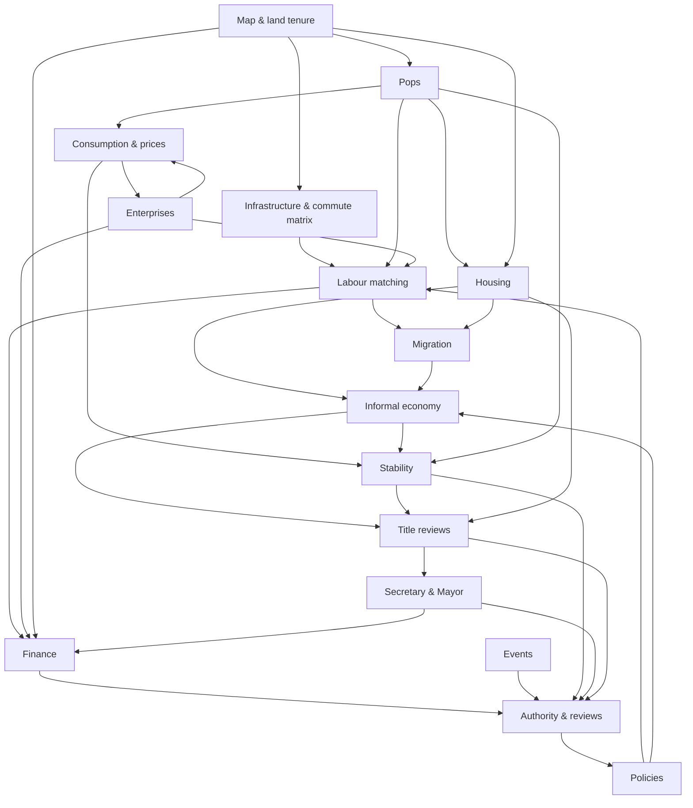

# A Circle Near the South China Sea
### Building the Special Economic Zone in a Reforming People's Republic
**Development plan, v0.3**

This is the plan for building the game with AI coding agents. It covers the design, the architecture, the research and data pipeline, the AI workflow and a phased roadmap. It is written so it can later become the project's `docs/` folder: each section can grow into its own spec file.

### Since v0.3
- **Sources checked.** The figures cited by the v0.3 review have been checked against their sources. Most of the figures held up and one citation was wrong. Four items were seen only in search summaries or could not be opened at all: the Yumin article, the 2014 yearbook figure, the NASA scenes and the GAIA licence. The results are in `docs/research/verification-log-2026-11.md`, and the plan below is updated to match.
- **New: the historical evidence protocol** (`docs/research/evidence-protocol.md`). It covers how to collect and verify figures, events, reports, maps, aerial imagery, GIS data and photographs, the status of each fact, and the minimum status required for each use in the game.
- **New: three system specs** in `docs/design/systems/`: `fiscal-and-macro.md`, `buildings-and-construction.md` and `leadership-and-reviews.md`.
- **A third review (November 2026) took infrastructure off the critical path.** The changes:
  - **Building records come in tiers.** Full records are kept only for routes, landmarks, observed buildings and blocks under redevelopment, a few thousand in all. Everywhere else the sim keeps floor-space stocks per block with a compact event log, and the renderer generates individual buildings from them.
  - **The evidence compiler has a draft mode.** In Phases 0–2, `lead` and `sourced` claims compile with an `[UNVERIFIED]` tag. Strict gating starts with Historical mode in Phase 3.
  - **Spike B moves to after Phase 1**, time-boxed. The first steps now go straight from the 2D map to the playable Phase 1 slice.
  - **The specs are the single source of truth for their schemas.** The duplicated TypeScript interfaces in §6.3 have been removed.
  - **Spec fixes:**
    - buildings: the bed-capacity bug, a stalled stage (烂尾), and minimal records for demolished buildings;
    - fiscal: baseline per-resident obligations, a rule for recurring deficits, the citywide ledger scope, and a cheaper investor preview;
    - leadership: discipline risk now grows from shortcuts the player accepts, campaigns are timed in months, there is one convention for lower-is-better indicators, and prestige-project mandates create obligations.

### What changed in v0.3
v0.3 folds in a second review, about the 3D city, buildings, population and the budget.

**Accepted:**
- **A recognisable 3D Shenzhen, plus a few walkable streets.** You can fly over the whole city at any date, with period-appropriate buildings everywhere. A few hand-checked **walkable routes** are reconstructed closely enough to stand where an archival photograph was taken. The first route is Yumin Village in Luohu, the second is in Shekou. Unrestricted walking stays a stretch goal. This partly reverses the v0.2 demotion of walking (§6.5).
- **Buildings with persistent histories below the grid.** A street-and-lane network sits under the 100 m grid, together with lightweight building records: footprint, floors by use, controller, construction date and alterations. The grid keeps only summaries. Facades are generated from each building's ID and history (§3.1, §6.3).
- **Historical starts compiled from dated evidence.** Observations (each with a date, source, reuse terms and confidence) are kept apart from saves and compiled into each start. The player's city can then diverge, and the overlay shows what really happened (§5).
- **Population by orthogonal attributes.** Registration, usual residence and length of stay, household, employment and village membership are now separate attributes, replacing the single status list (§3.2).
- **A small construction economy.** Floor space moves through stages: under construction, completed, occupied, vacant. Legal title is separate from development and compensation rights (§3.4).
- **A production loop.** Output each month is limited by orders, staff, floor space and utilities, and gross output, value added and financial flows are kept apart (§3.5, §3.6).
- **A budget made of obligations, not a fixed lock.** Your own decisions create recurring obligations. The player sees recurring money, money for projects, borrowing capacity and early import access. Phase 1 gets a simple project loan and investor co-financing (§3.6).
- **Spike B is replaced by one real walk test** that measures authoring hours per finished street (§10).

**Adjusted:**
- **Economic decisions stay at area level.** Area-level demand signals are passed down to parcels and buildings, so the v0.2 gain in debuggability survives the new building layer.
- **The 3D spike keeps a citywide scale check** next to the walk test.
- **Photographs are for reference.** Showing an archival photo in the game needs a licence for that photo.
- **Every figure the review cites is marked *cited by the review*** until we have opened the source ourselves. One of its links appears not to match the figures attached to it (Appendix C). *Update:* the November 2026 checking pass opened them; see "Since v0.3" above.

### What changed in v0.2
v0.2 folds in an external review. These points were accepted, some with changes:
- **Named areas instead of ~1,000 anonymous tracts.** Economics and pops now run on ~60–120 named areas (街道/片区). The 100 m grid stays for land, zoning and rendering. Villages are tracked separately as collective actors inside the areas, because urban villages need finer detail than the area level gives.
- **Quarterly player turns:** 120 turns for 1979–2009. The sim still steps monthly inside each quarter, so dated events and seasonal effects keep working, and crises can interrupt mid-quarter.
- **Walk mode demoted.** The 3D City view stays, so you can always stop and look, and street-level "postcards" are added. Free-roam walking moves to a late stretch phase. *(Partly reversed in v0.3: selected walkable routes are now core.)*
- **Shekou as a semi-autonomous enclave**, and **village joint-stock companies** together with the 1992 and 2004 rural-to-urban conversions.
- **New: a Party Secretary and Mayor pair**, with perks, corruption trade-offs and falls from grace (§3.9).
- **New: honorary-title reviews** such as 国家卫生城市 and 全国文明城市, with one-vote vetoes, campaign cleanups and re-reviews (§3.10).
- **Rebuilt finance and macro model** (§3.6):
  - four accounts;
  - the waterfall from gross to retained revenue;
  - fiscal regimes as data;
  - population counted three ways;
  - value-added GDP in both nominal and real terms.
- **Phase 1 now tests the core triangle:** growth, fiscal survival, and politics and reviews.

What was changed from the review:
- The review's percentages (for example "+25% investment") are kept only as *starting parameters* in data files, to be tuned by calibration.
- The review's historical dates and tax shares went into the to-verify timeline. Only items corroborated by search while drafting are marked ✓.

---

## 0. Key decisions at a glance

| Question | Default in this plan | Revisit if… |
|---|---|---|
| Turn length | **Quarterly player turns** (120 for 1979–2009). Each turn is simulated as three monthly sub-steps, and crises can interrupt mid-quarter | Phase 1 playtests show quarters are too coarse for the fast early years |
| Time span | 1979–2009 first; 2010–2019 as a later expansion | — |
| Engine / stack | **TypeScript + web**: a headless sim core, React UI, Three.js renderer. Desktop build later via Electron or Tauri. Python for the GIS data pipeline | You'd rather work in a game-engine editor, or want more ready-made 3D (see §6.1) |
| Map | Whole municipality (roughly 2,000 km²; sources give slightly different totals) on a **100 m grid** for land, zoning and rendering. Economics and pops run on **~60–120 named areas** (街道/片区), with villages as collective actors inside them. Only the 1980 SEZ (327.5 km²) is fully active at start; "outside the line" (关外) has less detail until it opens up | The map spike (§10, Phase 0) shows performance or data problems |
| Population | **Located pop groups** (Victoria 3-style pops tied to named areas), never individuals. Each group has separate attributes: registration, usual residence and length of stay, household and employment. They are counted three ways: registered (户籍), resident (常住) and actually present (实际管理) | — |
| Buildings | **Tiered.** Persistent building records, each with a stable ID and a history, for routes, landmarks, observed buildings and blocks under redevelopment (a few thousand). Everywhere else: floor-space stocks per block with a compact event log, from which the renderer generates buildings deterministically | Spike B shows the tracked tier needs to be larger, or the stock tier is too coarse for postcards |
| Views | One 3D scene. **Map** mode has a flat paper-map look. **City** mode lets you fly over the whole municipality at any date. **A few walkable routes** are hand-checked against dated photos and plans, starting with Yumin Village. Area **postcards** sit in between. Unrestricted walking is a stretch goal. The people and vehicles you see are cosmetic and generated from sim data | The walk test shows each finished street takes too many hours to author |
| Leadership | A **Party Secretary and a Mayor**, sometimes one person holding both posts. They are fictional archetypes with perks and corruption risks, rotated by higher levels | — |
| Scoreboards | **GDP and honorary-title reviews** (卫生城市, 文明城市 and others) as separate goals that pull against each other | — |
| Finance | **One transaction ledger** behind four player views: recurring money available, money for projects, borrowing capacity, and import access in the early game. Obligations come from a statutory baseline that grows with population, plus your own decisions, not from a fixed lock | — |
| Historical events | National events are **fixed anchors** in Historical mode, and the player chooses Shenzhen's response. Sandbox mode lets them drift with conditions | — |
| Start dates | **Dated observations are compiled into start saves.** Every start doubles as a "real city" overlay, and your city can diverge from it | — |
| North-star test | A **calibration harness** that plays the historical decisions headlessly and compares the result with yearbook data | — |

---

## 1. Vision and design pillars

**Pitch:** SimCity meets *China: Mao's Legacy*. You are the *spirit of the city*. You start in 1979 in a border county of fields, fishing villages and a small market town opposite Hong Kong, and you shape it into a megacity. You work inside the limits Beijing and Guangzhou allow, and you deal with an economy, a migrant population and a shadow city that never fully obey you.

**Pillars.** Every feature should serve at least one of these:

1. **You plan; the city happens.** You zone, lease land, build infrastructure and set policy. Investors, villagers and migrants decide what actually gets built. The gap between your plan and reality (illegal construction, urban villages, informal trade) is the heart of the game, not a bug.
2. **Permission is a resource.** Every policy is *sanctioned*, *grey-zone* or *forbidden*. Going ahead of Beijing ("crossing the river by feeling the stones") pays off, but it builds up political exposure. Your timing against the national political climate is the main strategic skill.
3. **History is the tide, not the script.** You cannot stop 1989 or bring the 1992 Southern Tour forward. You decide how Shenzhen weathers them. Sandbox mode loosens this; Historical mode keeps it.
4. **People in aggregate, stories in particular.** The simulation runs on groups. The player meets individuals through short vignettes: a factory worker from Hunan, a village landlord, a cross-border truck driver, a demobilised soldier, a market stall owner.
5. **Every grey zone has a ledger.** Smuggling, vice, counterfeiting, illegal building and labour abuse each bring visible benefits (jobs, cheap housing, growth, know-how) and visible costs (fires, disease, crime, scandal, central scrutiny). Nothing is just a "bad tile".
6. **The city is always viewable, and its streets remember.**
   - On any turn you can stop and fly over the whole city in 3D, open a postcard of any area, or walk one of the reconstructed routes.
   - Buildings keep their identity across decades. You can recognise a street thirty years later: the landlord added two floors, but the shop downstairs is still there.
   - This works because the simulation never depends on the renderer.
7. **GDP is not the only scoreboard.** Honorary-title reviews, performance reviews and your leaders' careers pull against raw growth. The cheapest way to grow (dense illegal housing, tolerated informality) is also the fastest way to fail an inspection.

**Explicit non-goals:** simulating individual residents, simulating a full bureaucracy (two leaders, not dozens of bureaus), real-time traffic physics, a full national economy model, and letting the player rewrite national history in Historical mode.

---

## 2. Core loop

### What the player does each turn
1. **Read the briefing.** A front page from a fictional local paper, directives from above, the quarter's reports and alerts.
2. **Resolve cards.** These include investor proposals, directives and mandated projects, crises, petitions and vignettes, as well as briefings with your Party Secretary and Mayor.
3. **Plan.** Draw and revise the land-use plan, lease land (by allocation, negotiation or auction once that is allowed), designate industrial zones and order reclamation.
4. **Build public works.** Roads, ports, power, water, schools, hospitals, public housing and checkpoints.
5. **Govern.** Turn policies on or off, set enforcement priorities (land inspection, vice, IP, labour safety, border) and divide up the budget.
6. **Lobby upward.** Spend political capital on permissions, quotas, central funds or protection.
7. **End the turn.** The simulation resolves and the results show up as deltas, map changes and new cards.

### What the player does *not* control
- Private construction, firms' hiring and location choices, and where migrants go.
- National politics, Hong Kong's economy, world demand, typhoons and epidemics.
- Whether their plan is obeyed. Enforcement capacity limits that.

### Cadence: quarterly turns, monthly simulation
The player takes one turn per quarter, which gives 120 turns for 1979–2009. Inside each quarter the sim runs three monthly sub-steps, so dated events, seasonal effects and monthly statistics still work. A crisis (a fire, a typhoon, a protest, a directive with a deadline) can interrupt mid-quarter with a card.

Each quarter has its own character:
- **Q1:** migrants leave and return for the Spring Festival, and the annual budget is adopted.
- **Q2:** the construction peak and the spring investment fairs.
- **Q3:** typhoon season, plus mid-year fiscal and inspection checks.
- **Q4:** year-end performance reviews, inspection verdicts and central policy shifts.

**Five-year plan** cycles frame the targets. Phase 1 should still test whether quarters feel too coarse in the fast early years. Because the sim is monthly inside each turn, changing the player's cadence later is a UI change, not a rewrite of the sim.

---

## 3. Game systems

Each system below becomes its own spec file (`docs/design/systems/<name>.md`) before any code is written.

### 3.1 Map and land
- **Grid:** 100 m × 100 m cells (1 ha). For the whole municipality that is about 200k cells, roughly half of them hills or water.
- **Named areas:** about 60–120 recognisable areas (街道/片区), such as Luohu Port, Dongmen, Shekou, Huaqiangbei, Baishizhou, Gangxia, Shatoujiao, Buji and Longhua.
  - Pops, services, jobs and commuting all work at area level.
  - Boundaries stay fixed for the whole game so that time series stay comparable. Names and administrative status change with history.
  - Players recognise and care about named places in a way they never would about "Tract #614".
- **Villages:** a few hundred village collectives sit inside the areas as economic actors that own land and floor space (§3.4). Urban villages need this finer detail; pops don't.
- **The Shekou enclave:** early Shekou was run by China Merchants (招商局), under a central ministry, not by the city.
  - It starts as a semi-autonomous enclave on your map.
  - It pioneers its own radical reforms in wages, hiring and housing, competes with you for investors, and clashes with your bureaucracy.
  - Folding it into normal city rule is a later decision, with gains and costs.
- **Beneath the grid: streets, parcels and buildings.** A 100 m cell can hold two alleys, ground-floor shops, rented rooms above them and a workshop behind. So the cell values are only summaries. Underneath them sit:
  - a **road network** in the sim (arterials and streets). Village alleys are generated for rendering, except on walkable routes, where they are traced;
  - **parcels**, each with a controller and its rights (see the next bullet). Outside tracked blocks, rights are held as block-level summaries;
  - **building records in two tiers** (buildings-and-construction §2):
    - *tracked buildings*, each with a stable ID, footprint, floors by use, controller, construction date and a list of alterations. These are the routes, landmarks, observed buildings and blocks under redevelopment;
    - *block stocks* for everything else: floor space by use, stage and legality, plus a compact event log ("a landlord added two floors"). The renderer generates individual buildings from the block's ID and history.

  Economic decisions are still taken at area level. They are passed down to parcels and buildings by a deterministic allocator, so the economy stays debuggable.
- **Dated terrain changes:** reclamation and major earthworks are recorded as dated events. Old views then show the old waterfront correctly.
- **Land title vs rights:** a single tenure flag would make clearance far too easy.
  - Each parcel records its **legal title**: state, village collective, military or reserved.
  - Separately, it records **development and compensation rights**: who may build, who must be compensated, and on what terms.
  - The 2004 conversion of Bao'an and Longgang moved collective land to state title while keeping specific claims and compensation arrangements. Title changed; the rights largely didn't.
  - Collective land is what produces urban villages. Villagers build to rent to migrants, often well beyond legal limits, and redeveloping their land means bargaining over rights whose value rises with land prices.
- **Planned vs actual use:** each cell stores both. The plan uses Chinese planning land-use classes (residential, commercial, industrial, logistics, public administration, green space, roads, utilities) and the colour conventions of Chinese planning maps.
- **Coastline epochs:** reclamation is a player action. The 1979 coastline differs a lot from today's.
- **The second line (二线关):** the SEZ management line, built from 1982 with checkpoints. It splits the map into inside and outside (关内/关外), with different rules, prices and pass requirements. It can be relaxed over time; historically it was formally abolished in 2018.

### 3.2 Pops (located groups)
Pops are sparse groups per area. The attributes below are **independent of each other**: a demobilised soldier can hold a local hukou, a village shareholder can work in a factory, and a migrant without a local permit can live in Shenzhen for years.

**Attributes of each group:**
- **Registration:** local hukou, non-local hukou, Hong Kong/Macau/Taiwan, or foreign.
- **Usual residence and duration:** the area where the group usually sleeps, and how long it has lived in Shenzhen (under six months, six months or more).
- **Household composition:** single people in dormitories, couples, families with children, plus how many children are eligible for local schools.
- **Employment allocation:** the share of the group in each sector and skill, and the areas where they work. Occupations are farming and fishing, factory, construction, services, informal work, state and administration, professional and technical, and entrepreneurs.
- **Village membership:** recorded only where it confers rights (shares, dividends, a house plot).
- **Origin tags:** used for vignettes and policy, for example transferred cadre or demobilised soldier.

**Each group also tracks:**
- size and a coarse age structure;
- income, spending and savings, plus **money sent home inland**, which is an outflow;
- needs satisfaction and mood;
- commute time.

**Demand comes from attributes, not from a label:**
- **School places** come from eligible children.
- **Beds** come from the people who sleep somewhere that night.
- **Daytime water and transport demand** come from where people are during the day, at home or at work.

So a Spring Festival departure frees a dormitory bed for a while, but the worker's usual residence stays the same.

**Needs:** housing, food, water, power, transport, healthcare, schooling, safety, leisure, consumer goods and status. Access to schools and healthcare is filtered by hukou status, which is a source of both realism and tension.

**Three population counts, always shown separately:**
1. **Registered (户籍人口):** limited by hukou quotas and births. This count drives the mandatory general-budget spending on public schools, healthcare for registered residents and welfare housing.
2. **Resident (常住人口, six months or more):** the yearbook figure, and the denominator for official GDP per capita.
3. **Actually present (实际管理人口):** adds short-term and unregistered migrants living in dormitories and urban villages. This count drives the real load on water, power, rubbish collection, housing, policing and sanitation, and so feeds the honorary-title reviews.

The gaps between the three counts are a story in themselves: a city that officially counts 10 million may be serving many more.

**How the counts are derived:** each count is a filtered sum over the group attributes.
- **Registered** = everyone holding a local hukou, wherever they usually live. The statistics bureau separates this total from the subset who actually live in the city, so the game tracks both.
- **Resident** = everyone whose usual residence is in Shenzhen and who has stayed six months or more, whatever their registration.
- **Present** = resident, plus everyone staying under six months or unregistered.

Any change of attribute (getting a residence permit or a hukou, staying past six months, being repatriated) is an explicit flow, so all three counts stay conserved. Record which **statistical vintage and geography** each target series uses (§7).

### 3.3 Labour, migration and hukou
- **Inflow** depends on the wage gap with inland regions, vacancies and migrant networks (a lagged "word of mouth" stock), less the barriers: border passes, checkpoint strictness, residence permit cost and the risk of detention and repatriation.
- **Outflow** happens through unemployment, unaffordable housing, the Spring Festival (not everyone comes back), crackdowns and economic shocks.
- **Labour matching:** a gravity model on the area-to-area commute-time matrix, split by sector and skill.
- **Player levers:** hukou quotas (the higher authority sets the ceiling), the temporary-permit regime, checkpoint policy, dormitory standards, minimum wage once it exists, and repatriation policy. Repatriation is a historical system and a morally loaded choice.
- **Emigration to Hong Kong** matters in the early years: escapes across the border are an early-game pressure that eases as Shenzhen's own opportunities grow.

### 3.4 Housing
- **Types:** factory dormitories, state-employer (danwei) housing, welfare housing, commodity housing, urban-village rentals, shacks and informal housing, and luxury or expatriate housing.
- **Rents and prices** come from supply and demand per area. Housing reform turns the welfare system into a market partway through the game.
- **Urban villages** are the pressure-release valve for affordable housing. Demolishing one forces the people living there somewhere else, and the knock-on effects should be clearly visible.
- **Village joint-stock companies (股份合作公司):** when villagers are converted to urban status, the village collective becomes a joint-stock company that keeps control of the land it has left. This happened inside the line from 1992 and outside it in 2004. These companies are active players:
  - they build rental floor space, often illegally, when migrant demand rises;
  - they run factories and markets, and pay dividends to villagers;
  - they demand steep compensation when you want to redevelop.

  Each village has its own leadership, with its own appetite for risk and its own ties to your officials.
- **Construction is a small economy of its own:**
  - **Builders weigh** expected occupied rents or sale prices against construction and financing costs and their access to land.
  - **Different builders behave differently.** A village household can respond to demand within months by adding a floor. A developer assembling a whole block must finance the clearance, negotiate rights and wait.
  - **Floor space moves through stages:** *under construction → completed → occupied or vacant*. Only completed space provides beds or workplaces.
  - **Announced is not built.** The city's 2011 housing plan says that by the end of 2010 only about 20,000 affordable units had been completed: 12% of the 169,000 arranged in 2006–10 (sourced; verification log V3). The gap between programmes and finished floor space is a historical pattern the game should be able to show.

### 3.5 Enterprises and investors
- **Aggregated industry blocks** (area × sector × ownership type) cover the long tail of firms. A few hundred **notable firms** are tracked individually. Each notable firm's numbers are taken out of its block, so nothing is counted twice.
- **The production loop runs monthly.** Actual output is the smallest of four limits:
  - orders;
  - staffed capacity;
  - usable floor space;
  - utilities (power and water).

  The sector's value-added ratio is then applied to the output actually produced (§3.6).
- **Ownership types:**
  - Hong Kong-linked processing and assembly (三来一补), where the Hong Kong office handles orders and the Shenzhen side does production (前店后厂);
  - joint ventures;
  - wholly foreign-owned firms;
  - branches of state firms from other provinces (内联企业), which were a big presence in the 1980s;
  - collective firms;
  - individual businesses (个体户);
  - private firms.
- **Investor proposals arrive as cards.** The player negotiates site, land price, tax holidays, labour terms and conditions. Each investor has an origin (Hong Kong, overseas Chinese, Japan, Taiwan, Western, inland state), with its own risk tolerance and sensitivity to the political climate.
- **Industrial ladder:** each sector unlocks with the era, infrastructure, skills and policy. The broad path runs from processing and assembly, through electronics and logistics and then high-tech and finance, to services and innovation.
- **The Huaqiangbei arc:** counterfeit and grey-market electronics build up *tinkering capital* in an area. If later policy allows it (financing, IP regime, talent), that capital turns into an innovation ecosystem. If not, it stays shadow trade. Stronger IP enforcement after WTO accession pleases foreign partners but hurts this pipeline.

### 3.6 Public finance and the macro model
Finance is the part of the sim that most needs to feel real. It should explain why a booming city can or cannot afford what it wants, for example the redevelopment of a particular street. The full spec is `docs/design/systems/fiscal-and-macro.md`.

**One ledger, many views.**
- Every money movement is recorded once in a transaction ledger, with a type, the account it touches and a date.
- Historical **reporting categories** are *views* over that ledger, and they change by era. For example, the city's 1994 budget report counted 5.5亿 of land-transfer receipts inside the 1994 budget, then moved land receipts out of the budget for 1995 (sourced; V7). The underlying transactions stay traceable, so calibration can compare like with like.
- Keep **citywide** and **municipal-level** figures labelled separately everywhere.

**There is no fixed budget lock.** A **statutory baseline** grows with population: administration, basic policing, compulsory schooling for eligible children and street cleaning. You can underfund it, but service gaps then hurt mood and review scores (fiscal-and-macro §6.1). **On top of that, obligations come from your own decisions:**
- **Opening a school or clinic** commits payroll and running costs for every future year.
- **Extending services to migrant families** commits recurring spending. The return is a healthier, better-served workforce.
- **Every new road or bridge** adds maintenance. The same 1994 report says basic construction took 35.5% of municipal-level spending, and that newly opened roads and bridges pushed maintenance spending up 47.36% (sourced; V5–V6).
- **Every loan** adds a repayment schedule.
- **A leader's prestige project (政绩工程)** comes with permanent maintenance and payroll, which last after the leader has gone.
- **A recurring deficit** never deadlocks the sim: it eats the reserve first, then forces a choice between short-term borrowing, using land money (grey or forbidden, depending on the era) and austerity (fiscal-and-macro §7.1).

The v0.2 placeholder of a 70–85% "locked share" is dropped. How much of the budget is spoken for now comes out of the sim.

**What the player sees:**

| View | What the simulation tracks | The decision it creates |
|---|---|---|
| **Recurring money available** | Retained taxes, fees and recurring transfers, minus payroll, service commitments, maintenance and debt service due | Every new service commits future revenue |
| **Money for projects** | The operating surplus, eligible grants and net land receipts, minus commitments on projects already started. Clearance, compensation and site servicing are deducted once, at the point they are paid | An auction can pay for a water main now. A cheap industrial lease gives up cash today for jobs and a possible future tax base |
| **Borrowing capacity** | Loans drawn, repayment schedules, project income and any city guarantee. Lenders respond to debt-service capacity and collateral (city investment companies, city-owned firms) | A port can open sooner. If traffic disappoints or land prices fall, its debt competes with the next project |
| **Import access** (early game, until the 1994 currency unification) | Retained or acquired foreign-exchange quota, alongside the yuan needed to buy equipment | An export processor or foreign partner can make a crane or generator obtainable before the city could buy one on its own |

**Early loans and co-financing are in from Phase 1.** Land and fees alone did not fund the opening years. A World Bank study (Shen & Xu, in *Untying the Land Knot*, 2012, pp. 90–91) reports that by the end of 1986, land-use fees came to only 1.5% of government revenue, or 6% of infrastructure capital investment. They did not even cover the interest on government bank borrowing (sourced; V13). A simple project loan with a repayment schedule gives the player a grounded reason to accept a partner's demanding terms.

**Investor cards show what the player can act on:**
- cash this quarter;
- the recurring fiscal effect, meaning the **tax the city would actually keep** from this enterprise after sharing, rebates and transfers;
- jobs created;
- the housing demand that follows.

The headline split (VAT 75/25 and so on) is not enough to tell the player what Shenzhen can spend, so the card shows the city's marginal retained tax instead.

**Auctions are not guaranteed money.** Bids, vacancy and credit conditions decide whether an auction actually pays well.

**The revenue waterfall is always on screen:** total tax collected in Shenzhen (全口径) → amount sent up to the centre and province → amount the city keeps. The balance changes by era. In the early 1980s the city kept most of what it raised. From the 1990s, according to the review, Shenzhen paid in far more than it got back, through customs duties, the central share of VAT and taxes on securities trading. The 1993 decision text assigns *securities trading tax* (证券交易税) 50/50 (V10). What was actually levied and shared in practice (securities trading stamp duty, 证券交易印花税, and any later shift of its split toward the centre) is `lead`. Derive the actual ratios for each era from the fiscal series. The waterfall explains why a booming city can still be short of money to build with.

> **Sourcing status of this section:**
> - **Sourced from primary documents** (see the verification log): the 1994 tax-sharing rules (V10), the 1994 budget figures (V5–V8), the 1986 land-fee figures (V13) and forex retention from 1979 to 1994 (V12).
> - **Still `lead`:** the 1980s contracting arrangement, the 2002–03 and 2008 regimes, the 2004 auction mandate, and the claim that Shenzhen paid in more than it got back.
> - Follow `docs/research/evidence-protocol.md` for each of them.

**Fiscal regimes are data, switched by national anchor events.** They never come from year checks in code. Each regime sets tax rates, sharing ratios and incentives:
- **1979 to the mid-1980s:**
  - fiscal contracting, with the city keeping a high share of any extra revenue;
  - SEZ tax holidays and a reduced corporate rate for foreign firms.

  The tax base is tiny, so the city lives on loans, processing fees and early land-use fees.
- **From 1987:** paid land transfer opens up land receipts as a source of project money. From 1990 the stock exchange brings in revenue from securities trading. The 1993 decision text assigns *securities trading tax* 50/50 to the centre and the city, and lists ordinary stamp duty as local (V10). What was actually levied and shared in practice (securities trading stamp duty, 证券交易印花税, and any later shift of its split toward the centre) is `lead`.
- **The 1994 tax-sharing reform (分税制):**
  - VAT is split 75% central, 25% local;
  - consumption tax and customs duties go 100% to the centre;
  - business tax on real estate, construction, finance and services stays 100% local, except tax paid centrally by the railways and by bank and insurance head offices;
  - enterprise income tax follows the firm's affiliation, and personal income tax is local;
  - the central rebate to localities uses 1993 as its base year, and grows at 0.3 times national VAT and consumption-tax growth.

  Source: the State Council decision of 1993-12-15 (sourced; V10).

  The player should feel straight away that factories bring jobs and GDP, while land, construction and property become the city's fiscal oxygen.
- **2002–2003:** corporate and personal income tax move to central–local sharing, ending at 60% central, 40% local.
- **2002–2004:** commercial and residential land must be sold by public auction or tender (招拍挂). Land revenue and house prices jump, and sweetheart deals get harder to arrange.
- **2008:** the unified enterprise income tax ends the general SEZ tax break for foreign firms. Only certified high-tech firms keep the reduced rate, so the tax code now rewards climbing the industrial ladder.

**Land scarcity:** a large share of the municipality is hills, water or protected ecological land. Measure the share from the elevation model and the land-cover data.
- Cheap, easily developed state land runs short over time; the timing should come out of the sim, not a script.
- Redeveloping urban villages (旧改) costs far more in compensation than early rural acquisition did, so the city earns less from each land sale.
- That pushes the player toward reclamation or a higher-value tax base.

**GDP is built up from value added (生产法)**, not gross output:
- Industry blocks add up into primary, secondary and tertiary sectors:
  - secondary covers industry and construction;
  - tertiary covers trade, transport, finance, real estate (including imputed rent), IT and services, and public administration.
- Each sector and ownership type has a `value_added_ratio`. It is applied to output actually produced (§3.5), not to capacity. Early processing and assembly (三来一补) produced large gross export values but little local value added, mostly processing fees. Without this ratio, 1980s GDP explodes as soon as exports boom.
- **Gross output, value added and finance stay separate:**
  - **A Hong Kong processing contract:** the gross shipment counts in *trade statistics*. Only the local processing work counts in *GDP*.
  - **Redevelopment:** local construction counts in GDP as the work is done.
  - **Lease premiums and loan proceeds** are financial flows. They go to the ledger, never to GDP.
- **Fiscal test cases for the spec:** the 1994 citywide and municipal budget totals (V8), plus the 1994 basic-construction share (V5).
  - The 2009 figures the review cited (¥276.53bn, ¥88.08bn, ¥100.08bn) are **unsourced**. Their link pointed to the 1994 State Council decision (V9), so they stay out until the 2009 budget report is found.
  - The 2008 figures from the 2009 government work report are only at `lead`: 全口径 2,830亿, central 2,029亿, local general budget 800.4亿.

**Nominal and real values are tracked separately:**
- Yearbook GDP totals, tax and land revenue are *nominal* (现价). Growth targets are *real* (不变价).
- An external national price deflator, plus local inflation from housing and other bottlenecks, links the two. This covers the inflation spikes of the late 1980s and mid-1990s and the deflation of the late 1990s. Exact rates come from the national series.

### 3.7 Infrastructure and utilities
- Roads and the road graph, ports, rail, the airport and border crossings.
- Bus and later metro networks.
- Power: shortages are a real 1980s–90s constraint, and factories run their own generators.
- Water: supply is a chronic constraint, tied to the regional supply that Hong Kong also depends on.
- Sewage and river pollution.
- **Mandated mega-projects** come from above. They take land and labour and may be locally unpopular. A nuclear plant that Hong Kong objects to is the archetype.

### 3.8 The authority layer (the "China" half of the game)
- **Actors:** the Centre (with reformist and conservative factions), Guangdong Province, Hong Kong (British until 1997, then a Special Administrative Region), and an abstract "world market".
- **Political climate** has two variables: a **reform wind**, which drifts and is moved by national events, and **central scrutiny**, which rises with campaigns, scandals and accidents.
- **Policy tiers:**
  - *Sanctioned* policies are safe.
  - *Grey* policies bring real gains but build up exposure. If the policy is later sanctioned nationally, the exposure turns into Pioneer credit.
  - *Forbidden* policies have large gains and large risks, and can trigger an investigation.
- **Political capital** is earned through performance and pioneering, and spent on permissions, quotas, central funds, mega-project choices and protecting your officials.
- **Performance reviews:** annual, with targets that change by era. Early targets are about foreign investment, exports and foreign exchange. Later ones add GDP and fiscal contribution, and later still stability, safety and environment.
- **Escalating powers:** the city can gain powers such as the right to pass its own local regulations, extensions of the SEZ and new pilot zones.
- **Failure states:** these are soft, such as lost autonomy, direct central management or recentralised land control. The hard failure is "the experiment is declared a failure", with SEZ status revoked, which ends the run.
- **Leadership:** see §3.9. **Honorary-title reviews** are a separate track; see §3.10.

### 3.9 The Party Secretary and the Mayor
The city has two leaders instead of a bureaucracy. The full spec is `docs/design/systems/leadership-and-reviews.md`.
- **Roles:**
  - The **Party Secretary (市委书记)** handles *politics and limits*: relations with Beijing and Guangdong, how fast political capital is earned, how much grey-zone exposure is tolerated, the ideological climate and national campaigns.
  - The **Mayor (市长)** handles *execution and the economy*: how fast and how cheaply things get built, investor negotiations, how efficiently taxes are collected and land is leased, and industrial policy.
- **One person or two:**
  - In some periods one leader held both posts (一肩挑), for example from May 1986.
  - A single leader means no internal friction and fast decisions, but a single point of failure.
  - A pair has a **synergy and friction** meter. An aggressive reformist mayor with a cautious secretary pulls the city in two directions.
- **You don't choose your leaders; you adapt to them.**
  - Higher levels rotate them every few years.
  - At inauguration each leader declares a **term mandate or pet project**, such as "win National Civilized City before my term ends" or "build a flagship CBD".
  - You meet them in recurring briefings: the inauguration, the annual budget, crises and lobbying trips to Beijing.
- **Traits make corruption tempting, not just a penalty.** Each leader has two or three traits. These are examples, and their numbers are starting parameters to tune:
  - *Deal-maker / land broker (政商通吃):*
    - gain: more private investment and faster land clearance;
    - cost: offers **shortcuts** (a sweetheart lease, a connected contractor, a buried inspection). Each one you accept brings less land revenue and raises a hidden **discipline risk (纪检风险)**. Declining keeps the risk low, but deals are slower and the leader's goodwill drops.
  - *Infrastructure patron (大干快上):*
    - gain: faster construction and easier credit;
    - cost: cost overruns and a higher chance of fires and building collapses.
  - *Parachuted cadre (空降干部):*
    - gain: central cover and more mega-project quotas;
    - cost: struggles to deal with village collectives.
  - *Local networker (本土派):*
    - gain: deals easily with Hong Kong and the villages;
    - cost: has no protection when Beijing cracks down.
  - *Clean technocrat (学者型):*
    - gain: no leakage of funds, and bonuses in inspections;
    - cost: refuses grey-zone shortcuts and slows deals down.
- **Fall from grace (落马):** hidden discipline risk, built up mostly from the shortcuts you accepted, can trip during an anti-corruption drive or after a disaster or scandal.
  - The leader is removed and put under investigation.
  - Major projects freeze for one or two quarters.
  - Central scrutiny spikes.
  - A cautious replacement arrives.
- **All leaders are fictional archetypes or composites** (see §11). Real history belongs in the encyclopedia, not in playable characters.

### 3.10 Honorary-title reviews (创建)
These give the game a second scoreboard and put direct pressure on the informal economy and illegal housing. They share a spec with the leaders. The years below still need verifying, except where marked ✓.
- **Multi-year campaigns, each unlocked in its era:**
  - **National Sanitary City (国家卫生城市)**, from the early 1990s. It covers sanitation, sewage and waste capacity, wet markets, street vendors, epidemic readiness and hygiene in urban villages.
  - **National Environmental Protection Model City (国家环境保护模范城市)**, from the late 1990s. It covers river and air pollution, keeping industry apart from housing, green space, and pushing dirty processing out of the core.
  - **National Civilized City (全国文明城市)**, from 2005, when Shenzhen was in the first batch (✓). This is the endgame test of governance. It needs thresholds to be met all at once on illegal building, vice and crime, traffic and street order, cultural facilities, migrant stability and safety.
  - **Optional extras:** Garden City, public-security reviews, and work-safety audits, which tighten sharply after a major disaster.
- **Hard thresholds plus a one-vote veto (一票否决):** even a high overall score fails if the review period includes any of these:
  - one catastrophic fire;
  - a major mass incident;
  - an epidemic cover-up;
  - a corruption case against a leader that touches a shortcut you accepted.
- **The illegal-building dilemma:** dense illegal housing and tolerated street markets are the cheapest way to house migrants and keep wages competitive. The reviews cap visible illegal floor area, blocked fire lanes and informality, and there are two ways to respond:
  - **Real investment:** public and affordable housing, sewage and clinics in urban villages, formal markets and enforced building codes. This is expensive and slows growth, but the improvement lasts.
  - **Campaign-style cleanup (运动式整治):** just before an inspection you sweep the street vendors, repaint facades (穿衣戴帽) and close non-compliant workshops for a while.
    - It is cheap and fast.
    - But it angers migrants and hurts informal income.
    - Everything comes back once the inspectors leave.
    - **Unannounced inspection teams (暗访组)** can catch you.
- **Re-reviews and losing a title (复审/摘牌):** titles are inspected again later.
  - Winning one brings political capital, helps your leaders' careers and attracts headquarters and high-tech investors who care about livability.
  - Losing one is a heavy political humiliation, and your leverage with Beijing drops sharply.

### 3.11 The informal and illicit economy
- Each area tracks intensities for:
  - illegal construction;
  - smuggling (including border shopping streets);
  - vice (karaoke bars, "hair salons", districts tied to mistresses of cross-border businessmen);
  - counterfeit goods;
  - combined factory–warehouse–dormitory buildings (三合一), a key fire risk;
  - wage theft and labour abuse;
  - organised crime.
- **Drivers:** demand, enforcement gaps, profit, migrant inflow and closeness to the border.
- **Benefits:** jobs, migrant absorption, cheap goods and housing, and an unofficial boost to growth.
- **Costs:** tax leakage, fire and safety disasters, disease, crime, damage to Hong Kong and foreign relations, and central scrutiny.
- **Enforcement:** budget plus priorities. Crackdowns push activity into neighbouring areas rather than removing it, and enforcers can be captured by the trade (a corruption risk).
- **Mandatory campaigns** come from above (crime crackdowns, anti-vice sweeps). They temporarily override your settings, so you have to take part and absorb the economic hit.

### 3.12 Society, stability and health
- Mood comes from needs, inequality, displacement and safety.
- That feeds strikes, protests, petitions and "mass incidents", which hit stability scores and scrutiny.
- Epidemics (with 2003 as the anchor), workplace accidents and major fires are emergent events. Their probability comes from sim state, such as how many 三合一 buildings there are and how strict safety enforcement is.

### 3.13 Hong Kong as a neighbour
Hong Kong is a persistent actor with its own simplified economy:
- **What it supplies:** capital, orders, managers and tourists.
- **What it demands:** labour, land, water, cross-border logistics, and the flows of vice and shopping.
- **Its relationship with you:** rises and falls with events (the 1997 handover, the 1997–98 crisis, later integration).
- **Practical integration:** border crossing capacity is something you build, and congestion at crossings is something you manage.

### 3.14 Consumption, supply and prices
This is where "needs must be met" and "income and spending" are actually calculated.
- **Monthly pop budget**, in order:
  1. income (wages, rents for villager landlords, profits for entrepreneurs);
  2. minus taxes and fees;
  3. minus rent;
  4. minus food;
  5. other needs, by priority and price sensitivity;
  6. remittances home;
  7. whatever is left goes to savings.

  Needs that go unmet lower satisfaction. The size of the gap is shown per pop and per area.
- **What supplies each need:**
  - *Public services* (schools, clinics, hospitals, transit): capacity per area, with access rules that depend on hukou status.
  - *Commercial floor space* (markets, shops, restaurants, entertainment): built by private actors in response to local spending, so demand creates retail jobs.
  - *Utilities*: network capacity for water and power.
  - *Informal supply*: street vendors, unlicensed clinics and vice, which fill gaps cheaply and add risk.
  - *Imports*: Hong Kong goods through border shopping streets and smuggling.
- **Money flows:** pop spending becomes revenue for the industry blocks that supply it. That revenue becomes jobs, wages and tax. This loop is what makes consumer growth matter alongside exports.
- **Prices and wages:**
  - A local price index responds to supply bottlenecks (housing, food, power), local credit and investment booms, and an exogenous national inflation series.
  - Early on, dual-track prices apply: planned prices and ration coupons alongside market prices, phased out by policy.
  - Wages by sector and skill are sticky. A minimum-wage policy unlocks later.
  - All money values are nominal, and real values come from the deflator (§3.6).
  - **Households have a cost-of-living index**, driven by rents and necessities. A housing boom can then squeeze workers even while manufacturing output rises.

### 3.15 System dependencies (build order)



**Tick order (one monthly sub-step; there are three per quarterly turn):**
1. external and national state;
2. events;
3. investment decisions;
4. construction progress and changes to buildings;
5. labour market;
6. production (orders, staff, floor space and utilities);
7. housing market;
8. migration;
9. needs and consumption;
10. informal economy;
11. finance (ledger postings and obligations);
12. stability;
13. statistics;
14. performance reviews, title reviews and leader rotation (when due).

---

## 4. Events, policies and content as data

All content lives in **schema-validated YAML files**, never in code. This is in the spirit of Paradox-style script modding, and it is what lets AI agents write hundreds of events safely and lets players mod the game.

```yaml
id: first_land_auction
title: { en: "The First Gavel", zh: "第一槌" }
kind: decision            # decision | news | crisis | vignette | directive
family: local_milestone   # national_anchor | local_milestone | emergent
historical:
  reference_date: 1987-12  # the real date: used by the autopilot and the encyclopedia, NOT a trigger
trigger:                    # the player can act once these hold; timing is their call
  all:
    - date_gte: 1986-01
    - policy_status: { id: paid_land_transfer, in: [grey, sanctioned] }
mean_time_to_happen: { months: 18 }
options:
  - id: open_auction
    effects:
      - account: { id: land_fund, add: "land_auction_revenue() - compensation_cost()" }
      - scrutiny: { add: 5 }
      - policy: { id: land_auction, status: grey }
  - id: negotiated_lease_only
    effects:
      - account: { id: land_fund, add: "0.4 * land_auction_revenue() - compensation_cost()" }
claims: [event.first_land_auction]       # claim ids in data/evidence/claims/; status lives on the claim
# the compiler refuses this event in Historical mode until each claim meets the minimum status for its use (evidence protocol §4)
```

**Rules:**
- **Three event families.**
  - *National anchors* fire on fixed dates in Historical mode, for example the 1992 Southern Tour or the 1994 tax reform. They change the climate, the rules and the targets. In Sandbox mode they can drift, with conditions.
  - *Local milestones* are Shenzhen's own historical firsts, such as the first land auction or the stock exchange. They are **timed by the player**: the action becomes available once its preconditions hold, and the real date is only a reference. Doing it earlier than history means more grey-zone exposure. This is pillar 2 in action.
  - *Emergent events* fire from sim conditions, such as fires, protests, scandals, investor walk-outs and vignettes.
- **Small expression language.** Triggers and effects use a deliberately small, typed language, parsed and validated at load time. Never use `eval`.
- **Policies are data too.** Each policy file holds its prerequisites, the permission tier for each era, effects and exposure rate.
- **Claims are required.** Every historical statement in content cites claim IDs from `data/evidence/claims/`. Content files never carry their own `verified` flag. The compiler reads each claim's status and refuses any use below its minimum (evidence protocol §4).
- **Localisation from day one.** Write English and Simplified Chinese strings side by side. Traditional Chinese, and some Cantonese flavour in dialogue, come later.

---

## 5. Historical evidence, snapshots and start dates

**Key idea:** keep the **historical evidence** separate from the **saves**.
- **Observations** are dated facts about the real city: a building seen on a 1984 image, a road on a 1986 map, a shoreline in a survey. Each one carries:
  - its observation date;
  - its source;
  - its reuse terms;
  - a confidence level;
  - whether it was **proposed or completed**. Plans such as the April 1980 Shekou plan must never be read as things that were built.
- **A compiler turns observations into a start save** for a given date. Where the evidence is incomplete, it estimates occupancy, construction in progress and fiscal commitments, and flags those values as estimates.

This split gives several features almost for free:
- **Multiple start dates:** compile and load a start save.
- **Real divergence:** a player who preserves a village in 1998 still sees it in 2009.
- **The "real city" overlay** shows what really replaced it, drawn from the observations.
- **Calibration checkpoints:** compare your sim state at a date with the compiled historical state.
- **Safe improvements:** a better reconstruction updates the observations and the next compiled start, but never silently changes a campaign in progress. Saves keep the compiled state they started from.

**Candidate snapshots:**
- 1979-03: the city is founded;
- 1980-08: the SEZ is established;
- 1984-01: first visit by Deng;
- 1992-01: the Southern Tour;
- 1997-07: the Hong Kong handover;
- 2001-12: WTO accession;
- 2009-12: end of the base game;
- later, 2019.

Start with **1979 and 1992 only**.

### Evidence and compile pipeline (Python, in `pipeline/`)
1. **Base geography:** a digital elevation model, rivers, reservoirs and hills. The coastline, reclamation and major earthworks are recorded as **dated terrain changes**.
2. **Expansion over time.** Status of each source is from the verification log; follow evidence protocol §5 for imagery and GIS:
   - **USGS aerial imagery from 1969 and 1977**, shown in a 2021 Shenzhen University exhibition (sourced; V15). The images are credited to the USGS, so look for the frames in the USGS archives;
   - **NASA Scientific Visualization Studio Landsat sequences** with nine scenes from 1973 to 2001 (lead; V16; open the pages);
   - **GAIA** (Gong et al. 2020), from 1985: annual estimates at 30 m of when land became impervious (built over). Reportedly CC BY 4.0; confirm the licence (lead; V17).

   GAIA can date *outward* expansion, but not redevelopment. A factory replaced by apartments sits on the same impervious pixels throughout. Redevelopment needs other sources: dated maps, photographs, plans and the gazetteers. Combine everything and correct it by hand in QGIS.
3. **Streets and lanes per epoch:** trace from historical maps, imagery and photographs. Present-day roads and buildings come from OpenStreetMap.
4. **Title, rights and villages:** village boundaries, collective land and development rights, from gazetteers and planning documents.
5. **Parcels and buildings:** generate them from local street patterns, ownership, floor-space demand and construction history. Where real observations exist, they override what is generated. Each building gets a stable ID.
6. **Named areas:** define the ~60–120 fixed area boundaries once, from present-day subdistrict lines, and give each one its historical names. Every cell belongs to exactly one area, and to one village if it has one.
7. **Population:**
   - Take district totals from the statistical yearbooks and spread them across each area's cells by built-up density and building type (dasymetric allocation).
   - Sum the cells back up into areas.
   - Split each area into pop types using the yearbook breakdowns: registered vs non-registered, and employment by sector.
   - Estimate the actually-present population on top, using published estimates where they exist, and flag it as an estimate.
8. **Economy:** sector output and employment by district, from yearbooks and the economic censuses.
9. **Political and fiscal state:** the policy tiers, open loans and other commitments, the leaders and the active directives at that date. Written by hand as data, with sources.
10. **Validation:** an automatic check of the compiled totals against the yearbook series, plus a visual overlay check.

### Walkable routes
A route is a short street or lane, hand-corrected against dated photographs and plans until a player can stand where a photograph was taken.

- **Yumin Village (渔民村), Luohu, comes first.** It packs nearly the whole game into a small area (the review says about 0.25 km², which is unconfirmed). The review cited *Shenzhen Noted*, but that article is behind a login. A search summary corroborates the 1992 shareholding company (渔丰实业股份有限公司) and redevelopment from 2001 (lead; V18). The history to check:
  - early houses and fishponds, with photographs;
  - dense "handshake" rental buildings by the mid-1990s;
  - a shareholding community from 1992;
  - redevelopment starting in 2001.

  From a single camera position the player can watch the effects of migration, village dividends, rising rents and a redevelopment bargain.
- **Shekou comes second.** Its industrial compounds and reclaimed shoreline need a genuinely different building kit.
- **Every route grows the shared kit.** The building parts, street furniture and materials made for a route are reused across the city.
- **Routes still follow the player's city.** The hand-checked buildings are ordinary tracked building records with stable IDs. If the player demolishes them, the route shows what replaced them, and the overlay shows history.
- **Photographs are licensed separately.** Archival photos can be used freely as private modelling reference. Showing one in the game, for example as a "then and now" view, needs a licence for that photo.
- **How many routes is set by measurement, not ambition.** Track the authoring hours per finished street from the very first route (§10).

**Data gotchas:**
- Check every dataset's licence:
  - US government satellite archives are generally public domain;
  - OpenStreetMap is ODbL, which requires attribution and share-alike for derived databases;
  - global built-up datasets usually require attribution;
  - historical maps vary.
- Chinese web maps use deliberately offset coordinate systems (GCJ-02 / BD-09). Keep everything in WGS84, and don't scrape commercial Chinese map services.
- Publishing maps of China inside China has its own legal rules. This only matters if you ever distribute there.

---

## 6. Architecture

### 6.1 Stack recommendation
**Recommended: TypeScript on the web.**
- **Simulation core:** `sim-core`, a plain TypeScript package with no DOM. It runs in a Web Worker in the game and in Node in the CLI.
- **UI:** React with a small state store.
- **Rendering:** Three.js for the map mode, the city mode, the postcards and the walkable routes, all in one scene.
- **Data pipeline:** Python with the usual GIS libraries.
- **Desktop and Steam builds:** a wrapper such as Electron or Tauri, later. Check the current options at that point.

**Why it fits AI-assisted development:**
- Coding agents are most fluent in TypeScript and web.
- Every project file is plain text: no binary scenes, no editor-only state.
- An agent can **run the game in a browser, take screenshots, click through it and fix what it sees** without you in the loop.
- Builds are trivial to share for playtesting.

**Named alternative: Godot 4 (GDScript or C#).** It gives you a much better out-of-the-box 3D toolkit: character controllers, navigation, lighting, an animation editor. It is fully open source.
- **Costs:** AI agents are less reliable with Godot's APIs (they mix up Godot 3 and 4), scene files are less pleasant to edit as text, and visual checks mostly need *you* in the editor.

**What should flip the decision:**
- You already know Godot or Unity well.
- You want the walk-through to feel like a real third-person game (physics, rich animation) more than a quiet stroll.
- You prefer working in an editor to reviewing code.

> Your own coding experience is the biggest unknown in this choice. If you have little, the web stack's "the agent can see and test it alone" advantage matters even more.

**In either case:** the simulation core stays engine-independent, so switching renderers later is only expensive, never fatal.

### 6.2 Non-negotiable architecture rules
1. **The sim is headless and deterministic.**
   - Signature: `step(state, playerActions, rng) → { state, events, stats }`. One call is one **monthly sub-step**, and a quarterly turn is up to three calls.
   - If a sub-step raises an **interrupting card**, the turn pauses and returns `{ state, pendingCards }`. It only resumes once every card has an answer.
   - Every card answer goes in the action log. In headless runs, the autopilot and the test bots must answer every card through a **decision policy** (scripted answers, falling back to a default option), so that runs never stall and stay reproducible.
   - All randomness goes through a seeded RNG. There is no wall-clock time inside the sim.
   - The same seed and the same inputs always give the same result.
2. **The renderer only reads sim state.** It never writes to it. Cosmetic people and vehicles are spawned from sim densities and flows, and are thrown away when you look elsewhere.
3. **Content is data.** Balance numbers live in parameter files. **No code may branch on a calendar year for balance reasons.** Dates appear only in content files that carry sources.
4. **Package boundaries are enforced by lint rules** (for example, `sim-core` must never import from `render` or `apps`).
5. **Invariants are property tests:**
   - population is conserved: births + inflow − deaths − outflow = Δpop;
   - money is conserved across accounts;
   - no negative stocks.

### 6.3 Data model sketch

**Each system spec owns its schemas.** This section only shows how the state fits together. Where a spec exists, its interfaces are the only ones agents should use:

| State module | Owner |
|---|---|
| Cells, roads and lanes, parcels, building records and block stocks | `docs/design/systems/buildings-and-construction.md` §2 |
| Ledger, obligations, projects, loans, forex, fiscal regime | `docs/design/systems/fiscal-and-macro.md` §3 |
| Leaders and title reviews | `docs/design/systems/leadership-and-reviews.md` §2.1 and §4 |
| Observations, claims, sources | `docs/research/evidence-protocol.md` §2 and §10 (never inside saves) |
| Pops, industry, policies, authority, Hong Kong | Sketched below until their specs exist. When a spec is written, move the interface there and delete it here |

```ts
// SKETCH ONLY, for modules that have no spec yet
interface Area { id: number; name: LocalizedString; services: ServiceLevels; enforcement: number; }
interface Village { id: number; area: number; status: 'rural'|'joint_stock'; floorArea: number;
  illegalShare: number; compensationDemand: number; leadershipRisk: number; }
interface Pop {
  area: number;                                   // usual residence
  registration: 'local'|'nonlocal'|'hmt'|'foreign'; stayedSixMonths: boolean; villageMember?: number;
  household: HouseholdType; eligibleChildren: number; originTags: string[];
  employment: { sector: Sector; skill: Skill; workArea: number; share: number }[];
  presentThisMonth: number;                        // drops during the Spring Festival
  size: number; ageBands: [number, number, number];
  income: number; savings: number; remittance: number;
  needs: Record<Need, number>; mood: number;
}
interface IndustryBlock { area: number; sector: Sector; ownership: Ownership; origin: Origin;
  jobsBySkill: number[]; grossOutput: number; valueAddedRatio: number; exports: number; taxPaid: number; informalShare: number; }
interface NotableFirm extends IndustryBlock { id: string; name: LocalizedString; traits: string[]; }
interface PolicyState { id: string; tier: 'locked'|'forbidden'|'grey'|'sanctioned'; active: boolean; exposure: number; }
interface AuthorityState { reformWind: number; scrutiny: number; politicalCapital: number;
  targets: Target[]; powers: string[]; }
interface GameState { date: YM;
  physical: PhysicalState;     // buildings-and-construction §2
  fiscal: FiscalState;         // fiscal-and-macro §3
  leadership: LeadershipState; reviews: TitleReviewState[];   // leadership-and-reviews
  areas: Area[]; villages: Village[]; pops: Pop[];
  industry: IndustryBlock[]; firms: NotableFirm[];
  authority: AuthorityState;
  policies: PolicyState[]; hongKong: HKState; pendingCards: CardInstance[]; history: StatsSeries; }
```

### 6.4 Performance check (order of magnitude)

| Item | Estimate | Note |
|---|---|---|
| Cells | ~200k × ~20 fields | ~10–20 MB of typed arrays, used for land, zoning and rendering |
| Pops | ~2,000–4,000 | ~60–120 areas × ~30 types, mostly sparse |
| Villages | a few hundred | Collective actors inside areas |
| Industry blocks | a few thousand | Area × sector × ownership, plus a few hundred notable firms |
| Commute matrix | ~100 × ~100 area pairs | Cheap enough to recompute whenever the network changes |
| Tracked building records | a few thousand, up to about 2×10⁴ | Full records, struct-of-arrays. Demolished ones shrink to minimal records |
| Block stocks | one per built-up block, at most about 10⁵ | Floor space by use, stage and legality, plus a compacted event log. Individual buildings exist only in the renderer |
| Sim road network | about 10⁴ edges | Village alleys are generated for rendering, except on routes. Commuting still uses the area matrix |
| A full headless run (360 monthly sub-steps) | target **well under a minute** | Required for the calibration loop; the Phase 1 slice has to show it is on track |

The heavy part is rendering, not the simulation. The 3D spike is there to prove that early.

The smaller economic model is mainly about **debuggability**. When 1995 GDP comes out a third too high, you and the agent need to be able to see which area and which sector caused it.

### 6.5 Rendering: one scene, three scales
- **Map mode:** an orthographic camera with a "paper planning map" look.
  - Land-use colours, hatching for informal areas, hand-drawn road styling and Chinese and English labels.
  - Data overlays: land value, density, share of registered residents, informality, pollution, service coverage, commute times.
  - The historical ghost overlay.
The renderer works at three scales:

| Scale | What is reproduced | How it is built |
|---|---|---|
| **Whole municipality** | Coastline, reclaimed land, settlements, major roads and rail, built-up extent and skyline | Dated geographic layers. Distant buildings are drawn as simple masses |
| **Neighbourhood** | Block sizes, lane patterns, factory compounds, village rentals, estates, building heights and uses | Generated from parcels, tracked buildings and block stocks. A tracked building's facade comes from its ID and history; other buildings are generated from the block's ID and event log |
| **Walkable routes** | Street width and slope, entrances, facades, signs, sightlines and landmark silhouettes | Hand-corrected against dated photographs and plans (§5) |

- **City mode:** a perspective camera over the whole municipality, with terrain, water, dated reclamation, buildings, day and night lighting, and weather (typhoons).
- **Postcards:** a street-level still or short animated diorama of any area, generated from its current state. The same street might be a muddy bicycle lane in 1982, a row of white-tile towers in 1995 and a canyon of handshake buildings in 2005.
- **Walkable routes (core, a few):**
  - Nearby blocks are streamed in, and repeated building parts are batched.
  - Doors, signs, pedestrians and collision are added only near the camera.
  - The walk is continuous and returns seamlessly to the citywide view.
- **Unrestricted walking anywhere** stays a stretch goal. It uses the same streaming, but it only looks good where the generated neighbourhoods hold up at eye level.
- **Facades come from history.** Each facade is generated from the building's ID and alteration history, so a landlord adding two floors leaves the shop downstairs recognisable.
  - Cosmetic crowds and vehicles match the era: bicycles in the 1980s, minibuses, motorbike taxis, container trucks queuing at the crossings.
  - Ambient sound matches the era as well.
- **Procedural buildings by era:**
  - 1980s walk-up blocks and factory sheds;
  - 1990s white-tile towers with blue glass;
  - urban villages of "handshake buildings" (握手楼);
  - 2000s glass towers and gated estates.

  The generator takes a tracked building record (footprint, floors by use, build year, alterations), or a block stock and its event log, and produces geometry from a kit of parts with era-specific facade textures. Only a handful of **landmarks** and the walkable routes are corrected by hand.
- **Scale techniques:** three-scale LOD hierarchy — coarse super-batched citywide masses (LOD0, ≤ 16 draw calls), frustum-culled 3.2 km spatial chunks with simplified instanced kits (LOD1), and streamed close-up tracked blocks with instanced Blender GLB details (LOD2). Full technical specification, UV/grounding rules, and asset budgets live in [docs/design/3d-modelling-protocol.md](docs/design/3d-modelling-protocol.md).
- **Chinese text:** the fonts are huge, so subset them and use SDF text rendering.

### 6.6 Repository layout

```
AGENTS.md                      conventions & commands for AI agents (keep short, keep current)
docs/design/                   pillars.md, systems/*.md, content-style-guide.md, sensitive-content.md
docs/research/                 evidence-protocol.md, verification-log-*.md, notes/; bibliography.yaml and timeline.yaml are generated views
packages/sim-core/             deterministic simulation (TS, no DOM)
packages/content/              YAML events, policies, archetypes, pop types, eras + JSON schemas + validator
packages/render/               Three.js scene: map / city modes, postcards, routes, procedural buildings
apps/game/                     React UI shell; runs sim-core in a Web Worker
apps/cli/                      headless runner, calibration reports, test bots
pipeline/                      Python GIS: raw data → observations → compiled start saves
data/raw/ (git-ignored)        large source data
data/evidence/                 sources, claims, observations, conflicts, derived values (versioned; see the evidence protocol)
data/raw/sources/<id>/         raw source files, stored with their sha256
data/routes/                   hand-corrected walkable routes and their reference notes
data/starts/                   compiled start saves (generated, versioned)
```

### 6.7 Saves, content packs and modding
- **Save file:** a JSON header (format version, date, seed, content-pack hashes) plus compressed binary typed arrays, with a migration function for each format version.
- **Content packs:** directories of YAML and assets, loaded in order. The base game is itself a pack. Sensitive themes can live in **separate packs** (see §11).

---

## 7. The calibration harness (north-star test)

This is how you know the simulation is *about Shenzhen* and not a generic city builder.

- **Historical autopilot:** a script file of the real decisions by date (policies, projects, land releases). The CLI plays it for the whole run.
- **Target series** are taken from the Shenzhen Statistical Yearbooks into `data/targets/*.csv`:
  - resident population, split into registered and non-registered;
  - GDP by sector;
  - industrial output;
  - exports;
  - foreign investment actually used;
  - fiscal revenue;
  - built-up area;
  - housing floor space.
- **Use census-revised series.** Shenzhen's population figures were revised after the 2000 and 2010 censuses. Use the retrospectively adjusted series in `data/targets/`, or the calibration will chase jumps that never happened.
- **Calibrate nominal and real values separately.** Check nominal GDP and budget totals against the yearbooks, and real growth rates against the official growth series.
- **Fiscal targets:** general-budget revenue, land-lease revenue where it was published, and the share sent up to the centre and province.
- **Population in three tiers:** the registered and resident series come from the yearbooks. The actually-present count is a model estimate, so check it only against published estimates.
- **Pick one statistical vintage, and label every series.** There are two figures for end-2009 resident population:
  - **8.9123 million**, from the city's 2011 housing plan (sourced; V1). The same plan gives 2.4145 million registered residents;
  - **9.9501 million**, from the 2014 statistical yearbook (cited by the review; not yet opened, V2).

  The conflict is recorded as `conflict.pop.resident.2009` (evidence protocol §6).

  Your 9,950,100 matches the later, census-revised vintage. The per-capita GDP in an earlier search implies about 8.84 million, which matches the earlier vintage. Every target series records its vintage, its geography (citywide or municipal level, inside the line or the whole city) and its definition.
- **The Phase 1 slice needs targets of its own.** Luohu–Shekou figures can't be compared with whole-city totals, so district-level series have to be found or estimated for the slice.
- **Report:** each run produces an HTML page with sim vs history charts and a pass or fail per series. The tolerance is around ±15–20% per year, plus separate checks on the *shape* of the curve: turning points, growth-rate peaks and dips, and changes in sector mix.
  - **Derive the shape features from the yearbook series. Don't take them from memory.** Popular narratives (for example "the 1989–91 slowdown" or "the 2008 crash") may not match Shenzhen's own figures. The 2008–09 GDP figures found while drafting still show double-digit growth.
- **Endpoint anchors, corroborated by web search and still to confirm in the yearbooks:**
  - 1979 resident population ≈ 314,100 (31.41万);
  - 1979 GDP ≈ ¥196 million (1.96亿元);
  - 2009 GDP ≈ ¥820 billion (8,201亿元);
  - 2009 resident population ≈ 9.95 million in the census-revised vintage (see the vintage note above).
- **Test bots:** besides the autopilot, run a random player, a "GDP-maximiser" and a "never take risks" player. They find exploits and dominant strategies long before human playtesters do.

> **Guardrail against overfitting:** AI agents asked to "make the calibration pass" will happily write `if (year === 1992) growth *= 1.4`. Forbid this in `AGENTS.md`. Tuning means changing **named parameters in data files**, and every change goes into a tuning log that explains why.

---

## 8. Working with AI: the development workflow

### 8.1 Four loops, each one something an agent can run largely on its own
1. **Spec → implement → test.**
   - You and the agent write `docs/design/systems/<system>.md`: what it simulates, inputs and outputs, formulas, parameters and invariants.
   - The agent implements it in `sim-core` with unit and property tests.
   - You review the diff and the behaviour, not every line.
2. **Run → calibrate → tune.** The headless CLI produces the calibration report. The agent reads the numbers, proposes parameter changes, reruns and explains the results.
3. **Research → draft content → verify.**
   - The agent turns your notes and sources (including Chinese-language yearbooks, gazetteers and newspapers it can translate) into event and policy YAML with citations.
   - The validator checks schema, references and dates.
   - **You** check the claims and sign them off as `verified` (evidence protocol §4). AI can extract claims and mark them `sourced`, but never `verified`.
4. **Play → screenshot → fix.** The agent runs the game in the browser, clicks through flows, screenshots the map and 3D views, and fixes the UI and rendering problems it finds.

### 8.2 What goes in `AGENTS.md`
- Commands for testing, the quick calibration run, the dev server and the content validator.
- The architecture rules from §6.2, stated as hard rules.
- "Every sim change keeps the tests and the quick calibration run passing, or explains why the golden numbers changed."
- Content rules: sources required, no invented quotes, a tone guide pointer, and both languages required.
- Keep it short. Long explanations live in `docs/` and are linked from it.

### 8.3 Habits that keep an AI-built codebase healthy
- **One system per session, in small commits.** Use plan mode for anything that crosses package boundaries.
- **Golden runs:** keep fixed-seed metric snapshots after N turns. Any change that moves them must say so.
- **Refactor regularly.** AI-written code drifts toward large files and duplicated logic; schedule clean-up passes.
- **Run independent tracks in parallel sessions:** pipeline, sim, renderer and content. The package split keeps them from colliding.
- **Treat AI history as a draft, never a fact.** Agents invent plausible dates, statistics and quotations with full confidence. The `sources` and `verified` fields exist because of this.

### 8.4 Assets with AI
- **Buildings and city fabric:** procedural code, which is the AI's strongest 3D tool. Text in, geometry out, and it can be tested.
- **Event illustrations and UI art:** generated in a fixed style guide, such as a paper-cut, poster or illustrated-newspaper look. **Never make photorealistic fake "historical photos"**, and never generate likenesses of real people.
- **Props and vehicles:** image-to-3D and text-to-3D generators are improving fast, so check the current options and their licence terms when you get there. Clean the results up in Blender.
- **Character animation:** use libraries whose licences explicitly allow use in games.
- **Music:** commission it or license it, and check AI-music licence terms carefully. Don't use real period songs without a licence.

### 8.5 What you must do yourself
- Decide what is fun, and playtest constantly from the first ugly build.
- Own the historical accuracy and the sensitivity calls.
- Choose the tone and the art direction.
- Review every merge, at least at the level of behaviour.

---

## 9. Research programme

Research is a deliverable in its own right and runs alongside all the build phases.

- **The evidence protocol** (`docs/research/evidence-protocol.md`) governs all research:
  - sources, claims, observations and conflicts live in `data/evidence/`, and raw files are stored by hash in `data/raw/sources/`;
  - statuses run `lead` → `sourced` → `verified`, and each use in the game has a minimum status that the compiler enforces;
  - `docs/research/bibliography.yaml` and `docs/research/timeline.yaml` are generated from the evidence, never edited by hand. Event anchors come from claims at `verified`.
- **Verification logs** (`docs/research/verification-log-*.md`) record each checking pass. The first is `verification-log-2026-11.md`.
- **Source categories:**
  - Shenzhen Statistical Yearbooks (深圳统计年鉴) for the time series;
  - local gazetteers (深圳市志);
  - city government records;
  - archives of the local press;
  - the economic censuses;
  - master plans;
  - oral histories;
  - academic books;
  - documentaries.
- **Starting reading list** (check the editions):
  - Ezra Vogel, *One Step Ahead in China: Guangdong under Reform* (1989);
  - Ezra Vogel, *Deng Xiaoping and the Transformation of China* (2011);
  - Mary Ann O'Donnell, Winnie Wong and Jonathan Bach (eds.), *Learning from Shenzhen* (2017);
  - Juan Du, *The Shenzhen Experiment* (2020);
  - Pun Ngai, *Made in China: Women Factory Workers in a Global Workplace* (2005), on factory life;
  - Winnie Wong, *Van Gogh on Demand* (2014), on Dafen;
  - Silvia Lindtner, *Prototype Nation* (2020), and Andrew "bunnie" Huang, *The Hardware Hacker* (2017), on Huaqiangbei and the maker scene.
- **Design references (games):**
  - *SimCity 4* and *Cities: Skylines* for zoning and the city view;
  - *Workers & Resources: Soviet Republic* for planned-economy logistics;
  - *Victoria 3* for pops and politics;
  - *Frostpunk* for laws with moral weight;
  - *Tropico* and *Suzerain* for political pressure;
  - *Papers, Please* for the checkpoint;
  - *This War of Mine* for vignettes;
  - *China: Mao's Legacy* for the authority theme.
- **Open-source code worth reading** (check their activity and licences):
  - [External resources reuse plan](docs/design/external-resources-plan.md): what to adopt, where it belongs, and what to test before integrating it.
  - Micropolis, the open-source release of the original SimCity;
  - A/B Street, a traffic simulation built on OpenStreetMap;
  - OpenTTD;
  - Cytopia.

---

## 10. Roadmap

There are no calendar promises here; each phase ends on **exit criteria**. Honestly, the full scope is a multi-year project for one person even with AI. AI speeds up the coding a lot, but not the design, research or playtesting. Phase 1 is the real test of whether the game is fun.

### Phase 0: Foundations and spikes
- **Repo setup:** the repo, `CLAUDE.md`, the pillars document and the skeleton bibliography.
- **Spike A, the map:** real elevation and the 1979 coastline for the whole municipality on a 100 m grid in the browser, with land-use colouring, smooth pan and zoom, and one data overlay.
- **Guardrails:** a lightweight YAML schema validator, and `evidence:compile --draft` (evidence protocol §9), which lets `lead` and `sourced` claims through with an `[UNVERIFIED]` tag.
- **Specs:** the Phase 1 slice spec, written before any Phase 1 code. (The fiscal, buildings and leadership specs already exist.)
- **Exit:**
  - The stack decision is confirmed for the sim and the 2D map. The 3D side is confirmed by Spike B.
  - Cell size and map extent are confirmed.
  - Nothing in Phase 0 builds 3D, archival tooling or a building serializer.

### Spike B (after Phase 1, time-boxed to about a week)
- **The walk (remaining human gate):** a short stretch of Yumin Village from tracked building records, shown in an early snapshot and a dense late one.
  - Walk continuously across a tile boundary, down a narrow lane and back out to the citywide view.
  - Measure frame-time spikes and memory.
  - Measure the **authoring hours per finished street**. This tells you whether ten such routes are affordable.
- **The scale check (technical pre-check passed, 2026-11-23):** verified on the real 931 × 686 DEM + 100k synthetic building masses + Phase B Blender GLB kits (3.97 MiB SoA RAM, 1.36 MiB gzipped save, 73.2 KiB/turn worker delta, 2.4–2.9 ms median GPU across LOD0/LOD1/LOD2 on integrated Radeon). Details in [docs/design/external-resources-plan.md](docs/design/external-resources-plan.md); engineering contract in [docs/design/3d-modelling-protocol.md](docs/design/3d-modelling-protocol.md).
- **Exit:** the 3D stack, the size of the tracked tier and a first cost per street are confirmed. Throw the spike code away afterwards, but keep the authoring notes.

### Phase 1: The ugly playable slice ("Luohu and Shekou, 1979–1984", 2D only)
The full spec is `docs/design/systems/phase1-slice.md`. It runs 21 quarters, from 1979-Q1 (still Bao'an County) to Deng Xiaoping's visit in January 1984. The SEZ's establishment in 1980 is the major early event, and the sites that already existed in 1979 are researched and flagged on the map.
Phase 1 tests the game's core triangle: **growth vs fiscal survival vs politics and reviews**. If that triangle is fun in ugly 2D, the whole project is validated.
- **Content:**
  - the grid and about 8–12 named areas around Luohu and Shekou. Shekou is a flagged area where you have less control; its full enclave behaviour arrives in Phase 2;
  - roads, zoning and land leasing;
  - about 6 building archetypes and 5 pop types, with registered and resident counts;
  - jobs and housing matching, and basic migration;
  - the **ledger**, with three views: recurring money, money for projects, and import access;
  - recurring obligations created by your decisions (payroll, services, maintenance);
  - **one simple project loan** with a repayment schedule, and **one investor co-financing offer** with demanding terms;
  - buildings as block stocks, at a basic level: stages (including stalled), floors added by village households. A handful of tracked buildings for landmarks;
  - **one Secretary–Mayor pair**, with a perk, a corruption trade-off and a pet goal;
  - **one early review target** alongside GDP, such as an export and forex quota plus a basic sanitation and order check;
  - about 15 events;
  - quarterly turns with monthly sub-steps;
  - save and load;
  - the CLI runner.
- **Left out of Phase 1** to make room:
  - the authority layer beyond a single climate value;
  - villages as full actors;
  - the informal economy beyond a single illegal-building value.
- **Exit:**
  - You can play all 21 quarters and the town grows plausibly in response to your choices.
  - Budget pressure and the review target force at least one hard trade-off a year. A loan taken today visibly squeezes a later year.
  - The slice is checked against its own Luohu–Shekou targets, not whole-city totals.
  - The headless run takes seconds, and the invariant tests pass.
  - You want to play it again.

### Phase 2: The authority layer
- **Content:**
  - policy tiers and political climate;
  - political capital and annual reviews;
  - leader rotation, the full set of traits, and falls from grace;
  - the first honorary-title campaign (National Sanitary City), with the one-vote veto;
  - the Shekou enclave as a full actor, with its own reforms and its rivalry with the city;
  - investor proposal cards;
  - about 40 policies;
  - the full event engine, with national anchors for 1979–1992.
- **Exit:** two playthroughs, one cautious and one aggressive, diverge in a meaningful way. Both 1989 and 1992 play out with real local decisions.

### Phase 3: The real Shenzhen
- **Content:**
  - the full map from the pipeline;
  - the full evidence tooling (intake with hashed copies, validation, status), the observation store, and the compiler that turns it into start saves. **Strict gating starts here:** Historical mode and calibration refuse `[UNVERIFIED]` data;
  - 1979 and 1992 compiled starts;
  - the ghost overlay;
  - calibration harness v1 (1979–1992).
- **Exit:** the historical autopilot stays within tolerance on population and GDP from 1979 to 1992, and the 1992 snapshot loads as a start point.

### Phase 4: Depth systems
- **Content:**
  - urban villages, village joint-stock companies, and the 1992 and 2004 conversions;
  - the fiscal regimes up to 2008, borrowing capacity and off-budget debt;
  - the full construction economy: developers, block assembly, title vs rights, vacancy;
  - the informal economy;
  - hukou, permits and the second line;
  - utilities;
  - the Hong Kong actor;
  - disasters and accidents;
  - ports, the airport and transit.
- **Exit:** every system has a spec and tests, and shows up in the calibration report.

### Phase 5: City mode, postcards and the first route
- **Content:**
  - facades generated from building histories, plus landmarks;
  - terrain, water and dated reclamation;
  - day and night;
  - cosmetic crowds and traffic;
  - street-level postcards for every area;
  - **the Yumin Village walkable route**, finished and checked against photographs.
- **Exit:**
  - On any turn you can stop, fly over the whole city in 3D, open a postcard of any area and walk the Yumin route, at an acceptable frame rate on a mid-range laptop.
  - The authoring-hours figure has been updated, and the number of further routes is decided from it.

### Phase 6: To 2009
- **Content:**
  - content for 1993–2009;
  - the Environmental Model City and Civilized City campaigns;
  - compiled starts for 1997, 2001 and 2009;
  - the Shekou route, plus whatever further routes the measured cost allows;
  - the full calibration pass.
- **Exit:** a full 120-turn run works, and the autopilot follows the historical curve.

### Phase 7: Polish and release preparation
- **Content:**
  - UX and the tutorial;
  - the in-game encyclopedia, with citations;
  - full English and Simplified Chinese, Traditional Chinese if possible;
  - accessibility;
  - external playtests;
  - the store page;
  - the decision on content packs.

### Phase 8: The 2010–2019 expansion
This covers:
- the SEZ extended to the whole city in 2010;
- the 2011 Universiade;
- new pilot zones;
- the metro build-out and the innovation economy;
- the end of the second line in 2018.

**Unrestricted walking anywhere** also belongs to this phase. It uses the same streaming as the routes, and depends on the generated neighbourhoods holding up at eye level.

---

## 11. Sensitive content and distribution

These topics are what make the game worth making. Handle them as **systems with human costs**, not as shock value.

### Principles
- Keep a documentary tone, give multiple perspectives, and back every claim with a citation in the encyclopedia.
- Show consequences on people through vignettes. Nothing is explicit: no sexual content, no gratuitous violence.
- The player's power is real and compromised. Demolitions, repatriation and crackdowns get the same narrative weight as ribbon-cuttings.

### 1989
- It is a national anchor event: the player cannot change what happens in Beijing.
- The player handles Shenzhen's local situation, the flight of investors, the jump in scrutiny and the slowdown that follows.
- Present it with restraint and with sources.

### Real people and companies
- National figures appear only through documented public actions and words, with sources.
- Local officials are fictional composites. Corruption storylines (§3.9) only ever attach to them, never to real officials.
- Use fictionalised analogues of companies (for example "a Taiwanese contract manufacturer"), especially next to themes like labour abuse. The encyclopedia can still describe the real history with citations.

### Distribution
- A game that covers 1989, vice and illegal activity will not realistically pass mainland publishing approval. Storefront availability and age ratings also vary by region.
- Building the sensitive themes as separable **content packs** (which the architecture already supports) keeps your options open.
- Before publishing, think about any personal, professional or legal exposure for you and your collaborators. Decide early whether you will publish under your own name.

Write `docs/design/sensitive-content.md` early. Agents will read it every time they draft content.

---

## 12. Risks and mitigations

| Risk | Mitigation |
|---|---|
| Scope explosion | Phase exit criteria. Phase 1 stays tiny. The 2010–19 period is an explicit expansion |
| It turns into a spreadsheet, not a game | Playable 2D slice first. Weekly playtests. Vignettes and visible city change from Phase 1 |
| Historical inaccuracy or invented facts | `sources` and `verified` fields, the validator, and human verification of every anchor |
| Calibration overfitting | Parameters only, never year branches. A tuning log. Bots that test sandbox divergence |
| Code quality decays under AI | Lint-enforced boundaries, tests and golden runs, regular refactor passes, small commits |
| 3D asset burden | Procedural buildings, a stylised low-poly look, few hand-made landmarks, 3D delayed to Phase 5 |
| Thin data for the 1980s | Lower-detail data early on, interpolation between snapshots, and transparent "estimated" flags in the encyclopedia |
| Sensitivity and distribution problems | Content packs, a sensitive-content guide, an early decision on how you publish |
| Phase 1 is now bigger (budget, leaders, a review) | Build the simplest version of each new piece. The authority layer waits for Phase 2 and the informal economy for Phase 4 |
| Balance numbers from reviews or memory get treated as fact | Every percentage lives in a parameter file and is tuned by calibration |
| Walkable routes eat the research budget | Measure authoring hours per street from Spike B onward, and fix the number of routes from that measurement |
| Too many building records | Tiered records: full records only where they matter, block stocks elsewhere, demolished records shrunk; the scale check in Spike B |
| Infrastructure crowds out the game (AI agents enjoy building pipelines) | Phase 0 builds no 3D, archival tooling or serializer. Evidence compiles in draft mode until Phase 3. Phase 1 must be playable before Spike B |
| Archival photos can't be shown in the game | Use photos as private reference by default, and license the few you want to display |
| Cited figures that turn out not to match their source | Every claim starts as `lead` until its source is opened (evidence protocol §4). The November 2026 pass confirmed one mismatched link (Appendix C, V9) |
| Solo burnout | Ship playable builds often, and share them with a small circle of testers |

---

## 13. Open decisions (defaults in bold)

1. **Stack:** **TypeScript on the web**, or Godot 4. It depends mostly on your coding experience and how much you want an editor.
2. **Map extent and resolution:** **the whole municipality at 100 m, with the SEZ active first**, or the SEZ only at 50 m.
3. **Turn length:** **quarterly turns with monthly sub-steps**, or monthly turns.
4. **Languages:** **English and Simplified Chinese from day one**, with Traditional Chinese later.
5. **Platform:** **desktop browser during development, then a desktop build for Steam**.
6. **Art direction:** **a paper planning-map look for the map, a restrained, period-faithful look for the city, and photo-matched detail on the walkable routes**, or stylised low-poly throughout. More realism on the routes means more authoring hours per street.
7. **Number of walkable routes:** **Yumin Village and Shekou, plus however many the measured cost per street allows**, or a fixed target.
8. **Area boundaries:** **present-day subdistrict (街道) lines, held fixed for the whole game, with historical names layered on top**, or boundaries that change with history.

---

## 14. First steps

1. Create a real project folder and a git repo. Add `CLAUDE.md`, `docs/design/pillars.md` (§1) and the empty `data/evidence/` tree from the evidence protocol.
   Add thin guardrails: a lightweight YAML schema validator, and `evidence:compile --draft`, which lets `lead` and `sourced` claims through with an `[UNVERIFIED]` tag.
2. **Spike A (map):** download the elevation data and trace the 1979 coastline roughly. Render the 100 m grid in the browser, with the 8–12 named Luohu and Shekou areas.
3. **The Phase 1 slice:** write `docs/design/systems/phase1-slice.md` together with the agent, then build the 21-quarter Luohu–Shekou slice (1979-Q1 to 1984-Q1) in 2D. It tests the triangle of obligations, loans and forex vs village illegal building vs the Secretary–Mayor pair and the early review.
4. **Playtest Phase 1** until you want to replay it. Fix the design before adding scope.
5. **Spike B (3D), time-boxed:** the Yumin walk and the tiered-building scale check (§10).
6. **The full evidence tooling** (`evidence:intake`, `evidence:validate`, `evidence:status`, strict `evidence:compile`). Its first job is intake of the November 2026 verification log: register each source, store a hashed copy in `data/raw/sources/`, and turn each row into a claim record.
7. **Verification sessions**, which can run alongside steps 3–6:
   - a person signs off the `sourced` claims;
   - opens the `lead` sources (995.01万, NASA SVS, GAIA licence, Yumin, securities stamp duty in practice);
   - finds the 2009 budget report;
   - pulls the population, GDP and budget series for 1979–2009 into `data/targets/`, noting the vintage and geography of each.

The system specs and the evidence protocol already exist (see "Since v0.3").

---

## Appendix A: Timeline anchors (seed list, to verify)

✓ = corroborated by web-search results while drafting. The pages were not read in full, so even these need a proper citation. *Sourced (Vn)* = the primary page was opened in the November 2026 pass (see the verification log). Everything else is unverified.

| Date | Anchor | Status |
|---|---|---|
| 1979-03 | Bao'an County becomes Shenzhen City | ✓ |
| 1979 | Shekou Industrial Zone begins (China Merchants) | verify |
| 1979 | Forex retention (外汇留成) begins, as a quota to buy foreign exchange | sourced (V12) |
| 1980-08-26 | Shenzhen SEZ established (327.5 km²) | ✓ date |
| 1981-11 | SEZ land regulations: land-use certificates for 20–50 years, annual land-use fees | sourced (V13, tier C) |
| 1982 | Second-line management fence begins (84.6 km) | ✓ |
| 1984-01 | Deng Xiaoping's first visit to the SEZ | verify |
| 1986-05 | One leader holds both the Party Secretary and Mayor posts (一肩挑) | ✓ |
| 1987-12 | First public auction of land-use rights | verify |
| 1988 | Price-reform panic buying; national retrenchment begins | verify |
| 1989 | National political crisis; investor flight and scrutiny | verify local details |
| 1990-12 | Shenzhen Stock Exchange begins operating | verify |
| 1992-01 | Southern Tour | verify |
| 1992 | Shenzhen granted local legislative power; share-subscription riot in August | verify |
| 1992 | Yumin Village shareholding company (渔丰实业股份有限公司) founded | ✓ (search summary only; V18) |
| 1992-06 | Rural urbanization inside the line begins; villages become joint-stock companies (first round ends in 2002) | ✓ |
| early 1990s | National Sanitary City title | verify year |
| 1993 | Major warehouse explosion and factory fire disasters | verify |
| 1993-12-15 | State Council decision on tax sharing, effective 1994-01-01 (VAT 75/25; business tax local, with exceptions; securities trading tax 50/50 in the text; 1993 rebate base) | sourced (V10) |
| early 1994 | Forex retention abolished; exchange rates unified | sourced (V12) |
| 1997-07 | Hong Kong handover; Asian financial crisis follows | verify |
| 1997 | National Environmental Protection Model City (first batch?) | verify |
| 1998 | Welfare housing allocation ends nationally | verify |
| 2001 | Yumin Village redevelopment begins | ✓ (search summary only; V18) |
| 2001-12 | China joins the WTO | verify |
| 2002–2003 | Income-tax sharing between centre and city, ending at 60/40 | verify |
| 2003 | SARS; custody-and-repatriation system abolished | verify |
| 2004 | Bao'an and Longgang urbanization: villagers converted to urban status, collective land passes to the state, villages become joint-stock companies | ✓ |
| 2004-08 | Deadline for selling commercial land only by public auction or tender (招拍挂) | verify |
| 2004 | Metro Line 1 opens | verify |
| 2005 | Shenzhen is in the first batch of National Civilized Cities | ✓ |
| 2008 | Labor Contract Law; global financial crisis; industrial upgrading push; unified enterprise income tax (high-tech firms keep the reduced rate) | verify |
| 2009-10 | ChiNext board launched in Shenzhen | verify |
| 2010-07 | SEZ extended to the whole city (expansion) | verify |
| 2018-01 | State Council approves abolishing the second line | ✓ |

## Appendix B: Pages found by searches while drafting
These are search hits whose summaries corroborated the ✓ items and calibration anchors. Open them and register them as sources in `data/evidence/` (evidence protocol §5) before relying on them.
- [China.com (2020): Shenzhen SEZ at 40](https://news.china.com/zw/news/13000776/20200826/38678804.html)
- [Beijing News (2020): Shenzhen statistics feature](https://www.bjnews.com.cn/detail/160255912015981.html)
- [Shenzhen 2011 Universiade site: economic overview](https://www.sz2011.org/oldsite/eng/service/content/2010-08/06/content_4813448.htm)
- [gov.cn (2018): State Council reply on the SEZ management line](https://www.gov.cn/zhengce/content/2018-01/15/content_5256812.htm)
- [Shenzhen government, "Shenzhen Story": the second line](https://www.sz.gov.cn/szstoryfr/202212/content/post_10341170.html)
- [The Paper: recollection of the early SEZ master plan](https://www.thepaper.cn/newsDetail_forward_2490737)
- [Hong Kong Education Bureau: chapter on the reform era (PDF)](https://www.edb.gov.hk/attachment/sc/curriculum-development/kla/pshe/references-and-resources/chinese-history/ancient_artifacts/Chapter24_sc.pdf)
- [Sina Finance (2018): profile of Li Hao's years in Shenzhen](https://finance.sina.cn/2018-01-04/detail-ifyqcwaq6991155.d.html)
- [Shenzhen government gazette (2004): Bao'an and Longgang urbanization](https://www.sz.gov.cn/zfgb/2004/gb396/content/post_5017278.html)
- [Zhong Lun: article on Shenzhen rural urbanization](https://www.zhonglun.com/research/articles/7827.html)
- [Sina Finance (2004): urbanization of the two districts](https://finance.sina.com.cn/g/20040630/1120842358.shtml)
- [Shenzhen government: city overview and honours](https://www.sz.gov.cn/cn/zjsz/gl/content/post_12318763.html)

## Appendix C: Sources cited by the v0.3 review (checked November 2026)
The historical sources were opened in the November 2026 checking pass, apart from *Shenzhen Noted*. Sources that pass found only through search summaries (NASA SVS, GAIA, Sohu) are listed at the end of the verification log. The quotes and statuses are in `docs/research/verification-log-2026-11.md`. Checked means at most `sourced`: each claim still needs a person's sign-off. Tracking parameters have been removed from the links.
- [Shenzhen Noted: Yumin Village, the changing meanings of farmer housing](https://shenzhennoted.com/2015/04/10/yumin-village-changing-meanings-of-farmer-housing/) (Yumin history and photographs): **not readable**, behind a login (V18)
- [Shenzhen University, School of Architecture and Urban Planning](https://saup.szu.edu.cn/info/1017/2206.htm) (USGS aerial imagery from 1969 and 1977, shown in a 2021 exhibition; credited to the USGS, V15)
- [Three.js docs: InstancedMesh](https://threejs.org/docs/pages/InstancedMesh.html) (a technical reference, not a historical claim; not checked)
- [Shenzhen government Q&A on hukou statistics](https://www.sz.gov.cn/hdjlpt/detail?pid=3102666&via=pc) (registered vs living in the city): supports (V11)
- [Shenzhen government gazette 2011: housing plan](https://www.sz.gov.cn/zfgb/2011/gb745/content/post_4983558.html) (8.9123 million residents at end-2009; 12% of affordable units completed): both supported (V1, V3)
- [National Bureau of Statistics: GDP concepts](https://www.stats.gov.cn/zs/tjws/zytjzbqs/gnsczz/202409/t20240909_1956324.html): supports (V14)
- [Shenzhen government gazette 1995: 1994 budget report](https://www.sz.gov.cn/zfgb/1995/gb71/content/post_10056253.html) (35.5% basic construction; land receipts presentation): both supported (V5–V8)
- [SAFE: history of foreign-exchange retention](https://www.safe.gov.cn/safe/2018/1109/10674.html): supports (1979 to early 1994; V12)
- [World Bank, *Untying the Land Knot* (2012), chapter by Shen & Xu (PDF)](https://documents1.worldbank.org/curated/en/622661468339570756/pdf/690730PUB0Publ067902B09780821389706.pdf): supports, pp. 90–91 (1986 land-use fees = 1.5% of revenue, 6% of infrastructure investment; V13)
- [State Council decision on the tax-sharing system, 1993-12-15 (Shenzhen gazette 1994)](https://www.sz.gov.cn/zfgb/1994/gb49/content/post_10090769.html): **the mismatch is confirmed.** The page has no 2009 figures, so the review's ¥276.53bn / ¥88.08bn / ¥100.08bn stay unsourced (V9). It is, however, a primary source for the 1994 tax rules (V10).
